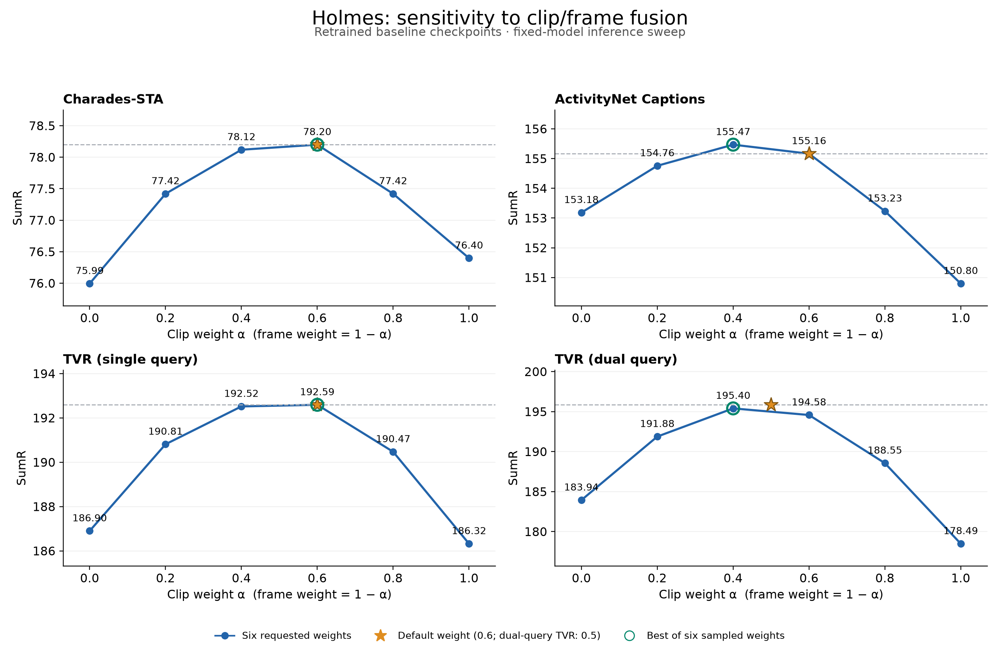

# Holmes 实验报告

2026-11-28｜16 组训练与重训权重敏感性分析均已完成。

## 1. 实验设置

全部对照使用自行从头训练的 Holmes 检索模型，输入为作者提供的预提取视频、文本特征；不重训底层特征提取器。每个数据集独立训练，TVR 另含双查询编码版本。两个版本都输入一句查询：单编码版本共享整句表示，双编码版本另用词级表示进行帧匹配。

原版与改进版共用训练循环、数据划分、优化器、学习率、选模及早停规则。环境为 RTX 5090 32GB、Python 3.12、PyTorch 2.7.1+cu128；FP32、关闭 TF32，seed=0、batch size=128、前 20 轮预热，沿用作者 BertAdam 与 warmup_linear 调度。原版和改进队列分别使用一张同型号显卡。

| 设置 | 训练视频 | 评测查询 / 候选视频 | 学习率 | 最多轮次 | 默认片段权重 |
|---|---:|---:|---:|---:|---:|
| Charades-STA | 5,338 | 3,720 / 1,334 | 0.0002 | 100 | 0.6 |
| ActivityNet | 9,043 | 15,753 / 4,430 | 0.00025 | 100 | 0.6 |
| TVR 单查询编码 | 17,435 | 10,895 / 2,179 | 0.0003 | 100 | 0.6 |
| TVR 双查询编码 | 17,435 | 10,895 / 2,179 | 0.0003 | 150 | 0.5 |

使用完整候选库，按验证集 SumR 选出最佳权重并评测。R@K 是正确视频进入前 K 名的查询比例（%）；SumR 为 R@1、R@5、R@10、R@100 之和。官方数据包的 val/test 描述文件相同，故只报告一套结果；本轮只有一个随机种子，不据此声称统计显著性或独立测试泛化。

## 2. 两项改动

**改动一：多局部证据聚合。** 将最高局部分数替换为 `0.5 × 最高分 + 0.5 × 前 3 个有效位置分数的均值`，同时用于片段和帧分支；不足 3 个位置时取实际数量，排除 padding，不要求位置相邻。双查询编码版本在词—帧匹配时应用相同聚合。

**改动二：查询自适应融合。** 小型网络 `384 → 64 → GELU → 1 → sigmoid` 预测片段权重 w，最终分数为 `w × 片段分数 + (1−w) × 帧分数`，初始值等于原默认比例。训练增加 `0.1 × CE(融合分数 / 0.1, 原标注)`；评价的是门控与附加损失这一整体改动。

分别训练原版、仅改动一、仅改动二、两项组合，在四种设置上共 16 组。

## 3. 重训与改进结果

Δ 为相对同数据集重训原版的 SumR 差值；所有数值由未舍入结果计算后保留两位小数。

| 设置 | 模型 | R@1 | R@5 | R@10 | R@100 | SumR | Δ |
|---|---|---:|---:|---:|---:|---:|---:|
| Charades-STA | 原版 | 2.63 | 8.87 | 13.82 | 52.88 | 78.20 | +0.00 |
| Charades-STA | 改动一 | 2.55 | 8.98 | 13.95 | 52.47 | 77.96 | -0.24 |
| Charades-STA | 改动二 | 2.42 | 8.71 | 14.35 | 51.85 | 77.34 | -0.86 |
| Charades-STA | 两项组合 | 2.53 | 8.98 | 14.33 | 52.18 | 78.01 | -0.19 |
| ActivityNet | 原版 | 8.73 | 27.22 | 40.36 | 78.85 | 155.16 | +0.00 |
| ActivityNet | 改动一 | 9.11 | 27.63 | 40.78 | 78.91 | 156.43 | +1.26 |
| ActivityNet | 改动二 | 8.51 | 26.34 | 39.30 | 78.16 | 152.31 | -2.85 |
| ActivityNet | 两项组合 | 8.46 | 26.10 | 38.98 | 77.92 | 151.46 | -3.71 |
| TVR 单查询编码 | 原版 | 16.78 | 38.32 | 50.22 | 87.27 | 192.59 | +0.00 |
| TVR 单查询编码 | 改动一 | 17.70 | 39.25 | 50.60 | 87.10 | 194.65 | +2.06 |
| TVR 单查询编码 | 改动二 | 15.34 | 36.78 | 48.24 | 86.53 | 186.88 | -5.71 |
| TVR 单查询编码 | 两项组合 | 15.61 | 36.45 | 48.26 | 86.36 | 186.68 | -5.91 |
| TVR 双查询编码 | 原版 | 17.74 | 39.60 | 51.29 | 87.22 | 195.85 | +0.00 |
| TVR 双查询编码 | 改动一 | 18.04 | 39.56 | 51.25 | 86.92 | 195.78 | -0.07 |
| TVR 双查询编码 | 改动二 | 13.33 | 33.36 | 44.53 | 84.92 | 176.14 | -19.72 |
| TVR 双查询编码 | 两项组合 | 13.03 | 32.41 | 44.49 | 84.85 | 174.78 | -21.07 |

- 改动一在 ActivityNet、TVR 单查询编码上分别提高 **1.26、2.06**；Charades 下降 0.24，TVR 双查询编码下降 0.07。收益并不覆盖所有设置。
- 改动二在四种设置上均下降，TVR 双查询编码下降 **19.72**；两项组合没有改善这一趋势，双查询编码下降 **21.07**。
- 训练中间检查曾观察到门控明显偏向片段分支，与融合扫描中单一路径较弱的现象一致。但附加损失和编码器也随之改变，尚不能把下降单独归因于门控权重。

## 4. 融合权重敏感性分析

固定各重训原版在默认比例下选出的最佳权重，只改变推理分数 `α × 片段分数 + (1−α) × 帧分数`。扫描 α=0、0.2、0.4、0.6、0.8、1.0；不为每个 α 重训或重新选模。TVR 双查询编码额外核验默认 α=0.5。该扫描是我们的补充实验，所用论文正文与附录未找到融合比例的敏感性分析。

| 片段权重 α | Charades | ActivityNet | TVR 单查询编码 | TVR 双查询编码 |
|---:|---:|---:|---:|---:|
| 0.0 | 75.99 | 153.18 | 186.90 | 183.94 |
| 0.2 | 77.42 | 154.76 | 190.81 | 191.88 |
| 0.4 | 78.12 | 155.47 | 192.52 | 195.40 |
| 0.6 | 78.20 | 155.16 | 192.59 | 194.58 |
| 0.8 | 77.42 | 153.23 | 190.47 | 188.55 |
| 1.0 | 76.40 | 150.80 | 186.32 | 178.49 |



Charades 与 TVR 单查询编码在六个点中以 **0.6** 最好；ActivityNet 以 **0.4** 最好，相比默认提高 **0.30**。TVR 双查询编码的六点最佳为 0.4（195.40），仍低于默认 **0.5（195.85）**。四种设置中，适当融合都优于只用一路；六点最佳不代表连续区间的全局最优。

## 5. 训练开销

下表耗时包含训练和评测，为各运行进程的实际用时；三组改进耗时相加。两条队列并行运行，因此不能把两列相加作为墙钟等待时间。

| 设置 | 原版耗时 | 三组改进合计 | 实际训练轮次：原版 / 改动一 / 改动二 / 组合 |
|---|---:|---:|---|
| Charades-STA | 0 小时 18 分 | 0 小时 55 分 | 47 / 44 / 42 / 42 |
| ActivityNet | 1 小时 20 分 | 5 小时 43 分 | 86 / 100 / 100 / 82 |
| TVR 单查询编码 | 2 小时 12 分 | 7 小时 12 分 | 100 / 100 / 100 / 100 |
| TVR 双查询编码 | 3 小时 23 分 | 10 小时 24 分 | 139 / 136 / 150 / 102 |

## 6. 数据与复跑入口

- [16 组完整指标 CSV](results/training-comparison.csv) · [训练结果原始 JSON](results/completed-training.json) · [配置、逐轮指标和最终结果归档](results/completed-training-records.tar.gz)。
- [敏感性扫描全部召回率与 SumR](results/fusion-sensitivity-retrained/metrics.csv) · [各项召回率曲线](results/fusion-sensitivity-retrained/recall-curves.png) · [SumR 矢量图](results/fusion-sensitivity-retrained/sumr-curves.pdf)。
- 训练入口：[train.py](train.py)；后续权重扫描：[queue_retrained_fusion.py](queue_retrained_fusion.py)；数据获取：[下载说明](../reproduction/README.md)。
- 模型权重保存在服务器 `/data1/quant_team/holmes-20261127/runs/{cha,act,tvr,tvr-multi}/{baseline,pooling,gating,combined}/`；`best.pt` 为最佳权重，`last.pt` 为训练断点。

单组重跑（双查询编码版本另加 `--multi`）：

```bash
python experiments/train.py --dataset cha --variant baseline --data-root <数据目录> --output <新输出目录>
```

`--variant` 可取 `baseline`、`pooling`、`gating`、`combined`；`--dataset` 可取 `cha`、`act`、`tvr`。
