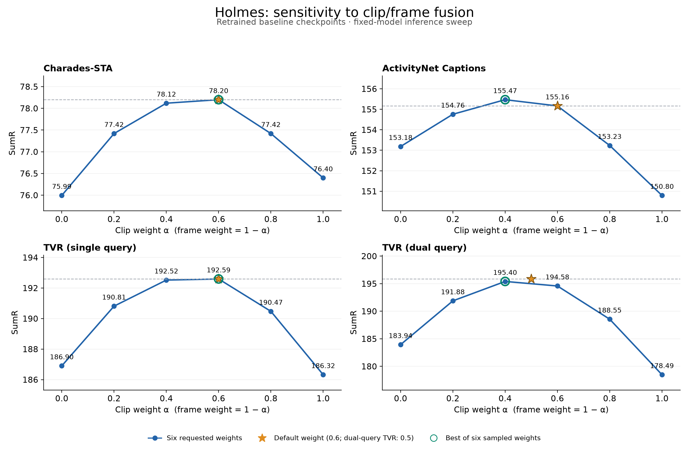
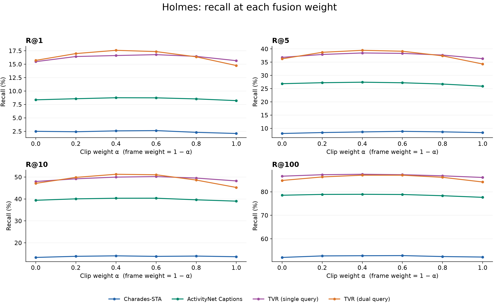

# Holmes 重训原版融合权重敏感性实验

固定同环境、seed=0 重训原版在默认比例下选出的 best.pt，扫描片段权重 0、0.2、0.4、0.6、0.8、1.0；不是为每个比例重新训练或重新选模。TVR 双查询额外核验默认 0.5。
默认比例的五项指标与重训 checkpoint 记录核验一致。四套均使用 RTX 5090、官方完整候选库和原评测代码；val/test 描述文件相同，不作为独立测试提升。

## SumR

| 片段权重 α | Charades | ActivityNet | TVR 单查询 | TVR 双查询 |
|---:|---:|---:|---:|---:|
| 0.0 | 75.99 | 153.18 | 186.90 | 183.94 |
| 0.2 | 77.42 | 154.76 | 190.81 | 191.88 |
| 0.4 | 78.12 | 155.47 | 192.52 | 195.40 |
| 0.6 | 78.20 | 155.16 | 192.59 | 194.58 |
| 0.8 | 77.42 | 153.23 | 190.47 | 188.55 |
| 1.0 | 76.40 | 150.80 | 186.32 | 178.49 |

| 设置 | 默认比例 | 重训默认 SumR | 六点中最佳比例 | 最佳 SumR | 差值 |
|---|---:|---:|---:|---:|---:|
| Charades-STA | 0.6 | 78.20 | 0.6 | 78.20 | +0.00 |
| ActivityNet Captions | 0.6 | 155.16 | 0.4 | 155.47 | +0.30 |
| TVR (single query) | 0.6 | 192.59 | 0.6 | 192.59 | +0.00 |
| TVR (dual query) | 0.5 | 195.85 | 0.4 | 195.40 | -0.45 |

六点中的最佳值仅用于描述当前公开评测集上的敏感性，不能作为独立测试提升或全局最优比例。它也不能直接解释重训门控模型的因果效果：门控模型的编码器已经改变。

## 文件

- `metrics.csv`：六个比例下四套模型的全部五项指标。
- `cha.json`、`act.json`、`tvr.json`、`tvr-multi.json`：权重哈希、环境、基准核验和原始结果。
- `sumr-curves.*`、`recall-curves.*`：PNG 预览，以及可用于汇报的 PDF/SVG 矢量图。
- 论文核对：[正文融合公式](../../../papers/holmes-zh/source/sections/Method.tex)、[附录 Parameter Analysis](../../../papers/holmes-zh/source/appendix_sections/Experiments.tex)。

- 复跑：`python experiments/queue_retrained_fusion.py --work <root> --gpu <UUID>`。
